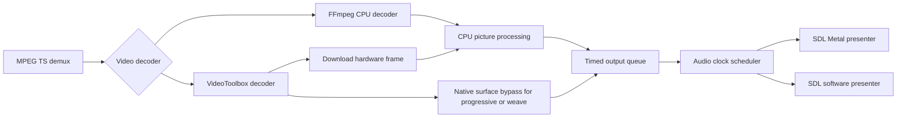

# ARM64 video playback roadmap

Implement software deinterlacing and field matching, add VideoToolbox hardware
decoding with Metal presentation on Apple Silicon, and retain complete CPU
playback on other ARM64 systems. This is the implementation handoff for the next
Hibiki developer. Milestones are planned work, dated November 24, 2026.

Budget approximately **3–5 developer weeks**, assuming access to Apple Silicon
and a representative Linux ARM64 machine. Estimates include implementation and
validation; hardware availability and stream-specific failures can extend them.
Native Metal ports of the software filters are a separate follow-on.

## Architecture and scope

Keep decoding, picture processing, scheduling, and presentation independently
selectable. VideoToolbox handles hardware decoding; Metal handles GPU
presentation and any later GPU processing. CPU filtering must also work when
presentation uses Metal.



Implement these paths:

| Path | Decode | Processing | Presentation |
| --- | --- | --- | --- |
| Portable baseline | FFmpeg CPU | CPU filters or bypass | SDL software or available GPU renderer |
| Apple hybrid | VideoToolbox when supported | Hardware-frame download, then CPU filters | Metal texture upload |
| Apple native surfaces | VideoToolbox when supported | Progressive or weave bypass | Metal surface import |

CPU playback is a supported product path on Apple Silicon and non-Apple ARM64.
NEON selection must follow the target architecture and runtime capabilities,
independently of Apple framework availability.
Native-surface bypass requires a compatible presenter; selecting software
presentation forces hardware-frame download.

## Milestone sequence

| Milestone | Deliverable | Depends on | Rough effort |
| --- | --- | --- | --- |
| M0 | Fixtures, diagnostics, presentation baseline | — | 1 day |
| M1 | Frame processing boundary and correct output timing | M0 | 2–3 days |
| M2 | CPU BWDIF, YADIF, Bob, and Weave | M1 | 2–3 days |
| M3 | Fieldmatch plus BWDIF film mode | M2 | 2–3 days |
| M4 | Portable ARM64 builds and NEON validation | M2; rerun with M3 | 1–2 days |
| M5 | VideoToolbox decode and CPU fallback | M2 | 2–4 days |
| M6 | Metal presentation and native surface import | M5 | 2–4 days |
| M7 | Settings, platform validation, and release | M3, M4, M6 | 2–3 days |

M0–M4 form a CPU release checkpoint. Keep each milestone reviewable as a separate
change, with its exit criteria recorded in the pull request.

## M0 Establish fixtures and a presentation baseline

> **Status 2026-11-24: implemented.** Fixture generation, verification and
> replay checks live in `tests/fixtures/`; the reference machines, dependency
> versions and recorded baseline are in
> [PLAYBACK_BASELINE.md](PLAYBACK_BASELINE.md).

1. Add reproducible short fixtures for progressive 720p59.94, interlaced
   1080i59.94, 480i, both field orders, hard 3:2 telecine, and mixed film/video
   edits. Here 1080i59.94 means 59.94 fields and 29.97 coded frames per second.
   Include incorrectly flagged input, non-square pixels, range/color bars,
   timestamp gaps, replay looping, and resolution changes.
2. Build fixtures from synthetic patterns with known motion and field parity;
   keep generation commands, expected timestamps, checksums, and reference
   outputs under `tests/`. Use local captures for additional visual validation.
3. Extend playback diagnostics with input codec/format, field order, decoded and
   output rates, active processing method, queue duration, and processing time.
   Record requested and active decoder/renderer separately.
4. Request VSync when supported, check the result, and log the active renderer
   and presentation behavior. Test moving edges on a physical display: pixel
   comparisons alone cannot diagnose display tearing. See
   [SDL VSync behavior](https://wiki.libsdl.org/SDL3/SDL_SetRenderVSync).
5. Name the reference Apple Silicon machine and minimum Linux ARM64 target,
   display refresh rates, and dependency versions before setting performance
   expectations.

**Exit:** Replay-based checks distinguish combing from presentation tearing;
baseline throughput, drops, A/V offset, and UI response are recorded.

## M1 Introduce the processing boundary and output timeline

> **Status 2026-11-24: implemented.** `src/video_processor.{h,cpp}` provides
> the libavfilter boundary; video decode/filtering runs on a bounded worker
> thread with generation-based resets. Synthetic tests cover pass-through,
> multiple outputs, changed sink time bases, unknown timestamps, EOF drain,
> cancellation and clean resets; the M1 pass-through baseline is recorded in
> [PLAYBACK_BASELINE.md](PLAYBACK_BASELINE.md).

Add a `VideoProcessor` between decoding and the display queue. Add `libavfilter`
to both frontend and test dependencies in CMake. Keep processing independent of
SDL and Apple frameworks so it can be tested without a window.

- Represent each queued output with an owned frame reference, integer PTS,
  rational time base, duration, and stream-generation identifier. Carry sample
  aspect ratio, color matrix/range, chroma location, and field metadata.
- Feed timestamped decoded frames into the processor; receive zero, one, or
  multiple outputs. Schedule using each output's time base, obtained from the
  filter sink. The current stream time base cannot simply be reused after
  filtering. Preserve unknown timestamps explicitly and test their fallback.
- Move video decode and temporal filtering to a bounded worker queue. Keep SDL
  texture operations, presentation, and the existing audio service on the main
  thread. Define synchronization for stream changes and stats snapshots.
- Bound buffers by bytes and media duration as well as frame count. Retain the
  existing audio master clock. Apply late-frame dropping to processed output
  without starving filters of the input history they require.
- Drain the decoder, then the filter graph, at EOF. Update `ended()` to account
  for worker and filter output. On retune, program/method change, discontinuity,
  or format change, discard obsolete generations and reset temporal history.

**Exit:** A pass-through processor preserves playback. Synthetic tests verify
multiple outputs, changed time bases, EOF drain, cancellation, and clean resets.
Menus remain responsive while video processing is busy.

## M2 Ship the CPU processing modes

> **Status 2026-11-24: implemented.** Auto, BWDIF, YADIF, Bob, Weave and
> pass-through are selectable (`--deinterlace`, `--field-order`,
> `--deinterlace-force`); all run through the SDL software renderer with the
> expected cadence and field structure. Reference tests and the recorded mode
> matrix are in [PLAYBACK_BASELINE.md](PLAYBACK_BASELINE.md).

Use FFmpeg's existing BWDIF and YADIF implementations. Define Bob and Weave
precisely; keep a small scalar reference for any application-owned pixel code.

| Mode | Intended behavior |
| --- | --- |
| Auto | Bypass progressive frames; apply BWDIF to frames marked interlaced |
| BWDIF | Motion-adaptive processing; default to one output per field |
| YADIF | Alternative temporal processing; default to one output per field |
| Bob | Reconstruct each field as a full-height progressive picture |
| Weave | Preserve paired fields at the coded frame rate; motion can retain combing |

Initial FFmpeg graph presets:

```text
bwdif=mode=send_field:parity=auto:deint=interlaced
yadif=mode=send_field:parity=auto:deint=interlaced
```

Provide force-processing and TFF/BFF overrides for bad metadata. Validate the
presets against the pinned FFmpeg version. See
[BWDIF](https://ffmpeg.org/ffmpeg-filters.html#bwdif) and
[YADIF](https://ffmpeg.org/ffmpeg-filters.html#yadif).

For Bob, choose and document vertical reconstruction, field phase, borders, and
interlaced chroma handling. For normal full-frame decoder output, Weave is a
pass-through; FFmpeg's separate-field `weave` filter is only appropriate if the
preceding stage actually emits individual fields.

Start with 8-bit planar 4:2:0 and 4:2:2; explicitly negotiate other formats.
Preserve color/range and aspect ratio through conversions. Validate NV12
conversion before connecting hardware decoding.

**Exit:** All modes work with the actual SDL software renderer. BWDIF, YADIF,
and Bob produce the expected 59.94 output cadence from interlaced 29.97 input;
Auto preserves progressive timing. Reference comparisons cover field order,
chroma, boundaries, frame counts, timestamps, and mode changes.

## M3 Add fieldmatch plus BWDIF

Expose a separate film mode with this initial graph:

```text
fieldmatch=order=auto:combmatch=full,bwdif=mode=send_frame:parity=auto:deint=interlaced
```

Fieldmatch reconstructs telecined frames; BWDIF treats remaining combed frames.
Field matching alone retains duplicate frames. Keep the nominal input cadence
in this milestone. Full inverse telecine requires a separate decimation policy;
unconditional decimation would be unsuitable for general mixed live content.
See [FFmpeg fieldmatch](https://ffmpeg.org/ffmpeg-filters.html#fieldmatch).

Keep ordinary Auto on the M2 policy. Film mode is explicitly selectable;
automatic cadence classification and optional 23.976 output can follow after
cadence-transition tests exist. Reset matching history on edits that trigger a
pipeline reset, retunes, and timestamp discontinuities.

**Exit:** Telecine fixtures reconstruct cleanly; residual combing uses BWDIF;
film/video transitions preserve duration and A/V sync. The UI identifies this
mode without implying that every broadcast is film or that duplicates were
removed.

## M4 Make ARM64 CPU playback portable and verify NEON

1. Separate CMake platform checks from architecture checks. Guard Objective-C++
   and Apple frameworks behind Apple feature detection. Add explicit CPU-only
   and Apple-video build configurations, plus a Linux AArch64 toolchain/preset.
   Make app-bundle copy/sign steps conditional in the build scripts.
2. Pin a compatible FFmpeg baseline and document required decoders and filters.
   Build its AArch64 assembly/NEON support for the target ABI and sysroot. Avoid
   host-specific `-march=native` in distributable or cross-compiled builds.
3. Use FFmpeg's existing optimized routines first. Upstream includes
   [AArch64 NEON dispatch for BWDIF](https://raw.githubusercontent.com/FFmpeg/FFmpeg/master/libavfilter/aarch64/vf_bwdif_init_aarch64.c).
   Verify the pinned version and supported formats; do not assume every filter
   has equivalent SIMD coverage.
4. Compare reference and optimized output. Profile real ARM64 hardware before
   adding intrinsics to Bob or conversion code; test vector tails, padded
   strides, alignment, and borders. Keep a reference implementation available.
5. Record CPU feature detection, FFmpeg configuration, and per-mode throughput
   on Apple Silicon in CPU mode and on non-Apple ARM64. Cross-compilation and
   emulation do not establish real-time performance.

**Exit:** Linux ARM64 builds and runs without Apple SDKs. CPU-only Apple builds
also work. Benchmark evidence demonstrates which optimized paths are active
and whether the named target sustains the intended workload.

## M5 Add VideoToolbox hardware decoding with CPU fallback

Integrate through FFmpeg's hardware-device/frame APIs in `open_video()`.
Enumerate codec hardware configurations, negotiate the hardware pixel format,
and own device/frame contexts explicitly. Use the
[FFmpeg hardware decode example](https://ffmpeg.org/doxygen/trunk/hw_decode_8c-example.html)
for device setup and hardware-frame transfer.

- Treat codec/profile/format support as a runtime capability. Specifically test
  ATSC MPEG-2 rather than inferring support from Apple Silicon or an FFmpeg
  decoder's advertised backend. Apple's
  [codec query](https://developer.apple.com/documentation/videotoolbox/vtishardwaredecodesupported%28_%3A%29?language=objc)
  is preliminary; session creation must also succeed.
- Distinguish actual hardware use from a VideoToolbox session that performs
  software decoding. Verify the available FFmpeg integration for Apple's
  [hardware-required option](https://developer.apple.com/documentation/videotoolbox/kvtvideodecoderspecification_requirehardwareacceleratedvideodecoder)
  and [active hardware property](https://developer.apple.com/documentation/videotoolbox/kvtdecompressionpropertykey_usinghardwareacceleratedvideodecoder).
- Auto decoding falls back to FFmpeg CPU on unsupported streams or initialization
  failure. A forced VideoToolbox diagnostic mode reports failure explicitly.
  Report the active decoder and fallback reason once per transition.
- Initially download hardware frames for every selected CPU filter. Preserve
  properties and validate NV12-to-planar conversion. Keep processing identical
  to the CPU-decoded reference path, and record transfer cost.
- On a recoverable runtime hardware failure, rebuild the decoder and temporal
  state, resume at a decodable random-access point, and re-anchor scheduling.
  Bound retries so a bad stream cannot cause an endless reopen loop.

**Exit:** A known supported stream uses verified hardware decoding. Unsupported
and injected-failure cases recover through CPU Auto mode. All software modes
work with downloaded hardware frames, without resource leaks or stale frames.

## M6 Present through Metal and import native surfaces

Select SDL's Metal renderer explicitly when available, retaining the existing
SDL HUD/menu composition. First complete the CPU-filtered texture-upload path.
Then import supported progressive/Weave VideoToolbox surfaces through
[SDL texture creation properties](https://wiki.libsdl.org/SDL3/SDL_CreateTextureWithProperties),
including `SDL_PROP_TEXTURE_CREATE_METAL_PIXELBUFFER_POINTER`, when the pinned
SDL version supports the required formats.

If a lower-level bridge is needed, isolate it in Objective-C++ and use
[Core Video Metal texture mapping](https://developer.apple.com/documentation/corevideo/cvmetaltexturecachecreatetexturefromimage%28_%3A_%3A_%3A_%3A_%3A_%3A_%3A_%3A_%3A%29?language=objc).
Retain pixel buffers, textures, and frame references until GPU use completes.
Define ownership, synchronization, resize, device-failure, and teardown behavior.

Preserve color conversion, limited/full range, crop/scale, sample aspect ratio,
OSD layering, and screenshots. Measure copies and synchronization rather than
assuming a surface wrapper guarantees zero-copy execution. If import fails,
use download/upload; if Metal is unavailable, use the portable presenter.

CPU filters continue to use the hybrid path. Native Metal BWDIF/YADIF/fieldmatch
kernels would require their own correctness and performance milestones; the
existence of VideoToolbox decoding does not provide those algorithms.

**Exit:** Metal presentation works for CPU-processed frames and supported native
surfaces. There are no lifetime errors, color regressions, or HUD regressions.
Physical-display testing confirms presentation pacing, and diagnostics identify
the native-surface versus download/upload path.

## M7 Integrate settings and qualify the release

Persist independent decode preference, processing method, field order, and
renderer preference. Default to Auto; expose backend overrides in advanced
controls/CLI for reproducibility. Apply changes through the same pipeline reset
logic. Keep H for the basic HUD and I for signal/playback diagnostics.

Suggested CLI values:

```text
--decoder auto|cpu|videotoolbox
--deinterlace auto|fieldmatch-bwdif|bwdif|yadif|bob|weave
--field-order auto|tff|bff
--renderer auto|metal|software
```

Add automated processing/timestamp tests to CTest. Keep hardware/display tests
separate from headless tests, and make unavailable hardware an explicit skip.
Run every software mode on both platform families, plus Apple hybrid/native
paths where supported. Include EOF, repeated retunes, capture looping, corrupt
packets, hardware failure, and repeated settings changes.

Proposed release gates, measured on the M0 reference machines:

- Sustain the selected 1080i59.94 workload with bounded queues and no sustained
  growth in memory after warm-up. Record CPU, processing latency, output rate,
  transfers, and drops separately for each path.
- Keep scheduled A/V error within 50 ms at the 95th percentile over a ten-minute
  fixture, excluding startup and deliberate discontinuities. Verify physical
  lip sync separately; internal clock statistics are insufficient alone.
- Keep ordinary controls responsive within 100 ms under the target workload.
  Preserve expected field order, output duration, aspect ratio, and colors.
- Publish the measured minimum ARM64 target and any modes that exceed its
  performance budget. Keep quality choices explicit; never silently switch to
  Weave or relabel CPU work as hardware acceleration.

**Exit:** Existing frontend/PSIP/firmware tests pass, new processing tests pass,
and the platform/mode matrix has recorded results. Update README controls,
build/dependency instructions, troubleshooting, and the active-path diagnostics.

## Code ownership and starting points

| Existing area | Expected work |
| --- | --- |
| `src/player.h`, `src/player.cpp` | Processor boundary, timestamped output queue, worker lifecycle, hardware decode, frame ownership, stats |
| `src/sdl_frontend.cpp` | Renderer selection, VSync, settings, diagnostics, picture presentation; retain H/I behavior |
| `src/osd.h`, `src/osd.cpp` | Preserve composition across presenters; change only where integration requires it |
| `CMakeLists.txt` | `libavfilter`, optional Apple frameworks/sources, ARM64 presets, test targets |
| `scripts/build.sh`, `scripts/sign.sh` | Portable build steps and conditional macOS packaging |
| `tests/frontend_tests.cpp` and new processing tests | Controls, frame/timestamp references, resets, format changes, fallback |

Suggested new boundaries are `src/video_processor.{h,cpp}` for CPU processing
and `src/apple_video.mm` for any Apple-specific bridge. Introduce a presenter
interface only as needed to keep SDL resource work on the main thread; avoid
spreading platform conditionals through the scheduling and filtering code.

Start with M0 and M1. Ship the CPU checkpoint after M4; validate the Apple
hardware path before making hardware Auto the release default for each codec.
